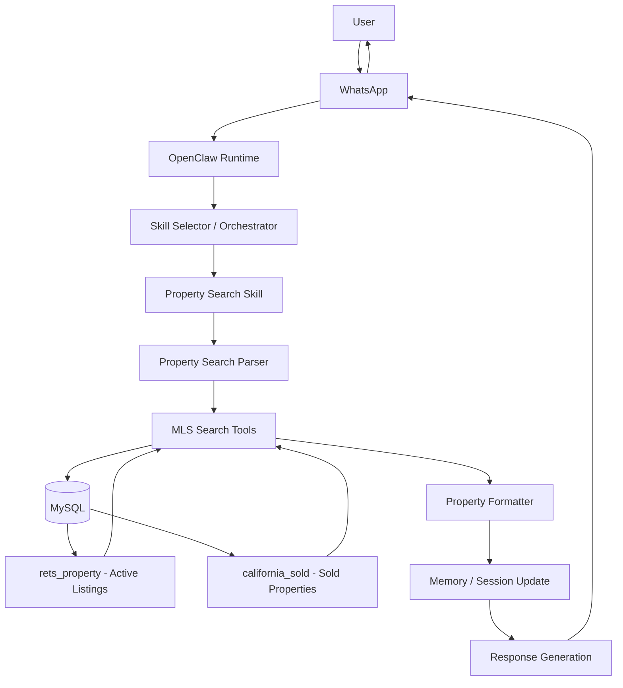

# Week 1 – OpenClaw Architecture Fundamentals

## Project Overview

The IDX Exchange Agentic AI project is an AI-powered real estate assistant built using OpenClaw. Users can communicate with the agent through WhatsApp using natural language.

OpenClaw manages the conversation, routes the user's request to the appropriate skill or tool, accesses MLS property data stored in MySQL when required, and returns the response to the user.

## System Architecture

The high-level OpenClaw workflow is:

User → WhatsApp → OpenClaw Runtime → Skill Selector → Tool Execution → Memory Update → Response → User

## Key Components

- **Skills** — Modular capabilities such as property search and sold comparable searches.
- **Channels** — Communication interfaces such as WhatsApp.
- **Sessions** — Maintain conversation state for each user.
- **Tools** — Functions used to perform operations such as querying MLS data.
- **Memory** — Maintains short-term and long-term context.
- **Orchestrator** — Routes user requests to the appropriate skill or tool.

## IDX Exchange Architecture Workflow

## Current Implementation

The project currently contains TypeScript modules for:

- Natural-language property search parsing
- MySQL database connectivity
- Active listing searches
- Sold comparable property searches
- Property result formatting

These components provide the foundation for connecting OpenClaw skills to the MLS databases in subsequent project stages.

## Week 1 Deliverable

Architecture documentation and workflow diagram demonstrating how a user request travels from WhatsApp through OpenClaw skills and tools to the MLS databases and returns a response to the user.
